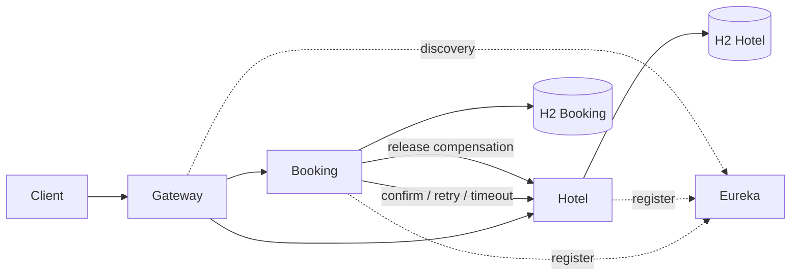

# Hotel Booking Platform

Учебная микросервисная система бронирования гостиниц на Java 17, Spring Boot 3.5.5 и Spring Cloud 2025.0.0. Четыре самостоятельных Spring Boot приложения используют отдельные базы H2 в памяти и обнаруживают друг друга через Eureka.

## Модули

- [Eureka Server](eureka-server/README.md) — реестр сервисов, порт `8761`.
- [API Gateway](gateway/README.md) — маршрутизация и сквозной `X-Trace-Id`, порт `8080`.
- [Booking Service](booking-service/README.md) — пользователи, JWT и сага бронирования, порт `8081`.
- [Hotel Service](hotel-service/README.md) — гостиницы, номера, занятость и рекомендации, порт `8082`.

Общие сведения об архитектуре, API и проверках находятся в этих разделах; здесь описаны только общие установка и запуск, чтобы не повторять инструкции в каждом модуле.



## Требования

- Git.
- JDK 17 или новее.
- Apache Maven 3.9 или новее.
- Свободные локальные порты `8080–8082` и `8761`.

Spring Boot, Spring Cloud, Spring Security, Spring Data JPA, H2, Springdoc и JUnit подключаются как Maven-зависимости из `pom.xml`. Отдельно устанавливать эти Java-библиотеки не нужно. BOM Spring Cloud и версия Spring Boot указаны в корневом `pom.xml`.

## Получение проекта

Подставьте адрес Git-репозитория, выданный преподавателем:

```bash
git clone <URL-репозитория> hotel-booking-platform
cd hotel-booking-platform
```

Если проект уже скачан, достаточно перейти в каталог корневого `pom.xml`.

## Установка JDK и Maven

### macOS: Homebrew

```bash
brew install --cask temurin@17
brew install maven
export JAVA_HOME=$(/usr/libexec/java_home -v 17)
export PATH="$JAVA_HOME/bin:$PATH"
java -version
mvn -version
```

Если JDK 17 уже установлен, установите только Maven и задайте `JAVA_HOME`.

### Ubuntu / Debian

```bash
sudo apt update
sudo apt install -y openjdk-17-jdk maven git
java -version
mvn -version
```

### Windows

Установите JDK 17 (например, Eclipse Temurin), Maven 3.9+ и Git. В PowerShell проверьте:

```powershell
java -version
mvn -version
git --version
```

Для Windows задайте `JAVA_HOME` на каталог JDK 17 и добавьте `%JAVA_HOME%\bin` и каталог `bin` Maven в `PATH`.

## Сборка и автоматические тесты

Из корня проекта:

```bash
mvn clean verify
```

Maven компилирует все модули, запускает JUnit-тесты и создаёт JAR-файлы в `target/`. Только тесты Booking Service:

```bash
mvn -pl booking-service test
```

Набор тестов проверяет успешное подтверждение бронирования, ошибку Hotel Service, тайм-аут удалённого вызова и повторную доставку `requestId`. Подробности ручной проверки каждого сервиса приведены в README этого модуля.

## Запуск приложения

Оставьте каждый процесс в отдельном терминале. Запускайте в порядке: Eureka, Hotel Service, Booking Service, Gateway.

```bash
# Терминал 1
mvn -pl eureka-server spring-boot:run
```

```bash
# Терминал 2
mvn -pl hotel-service spring-boot:run
```

```bash
# Терминал 3
mvn -pl booking-service spring-boot:run
```

```bash
# Терминал 4
mvn -pl gateway spring-boot:run
```

В IntelliJ IDEA откройте корневой `pom.xml` как Maven-проект и запускайте `spring-boot:run` для каждого модуля отдельно.

### Локальные секреты

Для демонстрации в YAML заданы локальные значения. Booking Service и Hotel Service должны использовать одинаковые `JWT_SECRET` и `INTERNAL_SERVICE_KEY`. Чтобы задать их явно, выполните в обоих терминалах до запуска сервиса:

```bash
export JWT_SECRET='replace-with-a-long-random-secret-at-least-32-bytes'
export INTERNAL_SERVICE_KEY='replace-with-a-separate-internal-key'
```

Значения по умолчанию годятся только для локального учебного запуска.

## Полезные адреса

- Gateway API: `http://localhost:8080`
- Eureka Dashboard: `http://localhost:8761`
- Booking Swagger UI: `http://localhost:8081/swagger-ui.html`
- Hotel Swagger UI: `http://localhost:8082/swagger-ui.html`
- Booking H2 Console: `http://localhost:8081/h2-console`
- Hotel H2 Console: `http://localhost:8082/h2-console`

Для H2 Console используйте пользователя `sa`, пустой пароль и JDBC URL `jdbc:h2:mem:bookingdb` либо `jdbc:h2:mem:hoteldb`.

Демо-учётные записи и сценарии `curl` описаны в [документации Booking Service](booking-service/README.md). Все H2 данные очищаются при остановке процессов.
